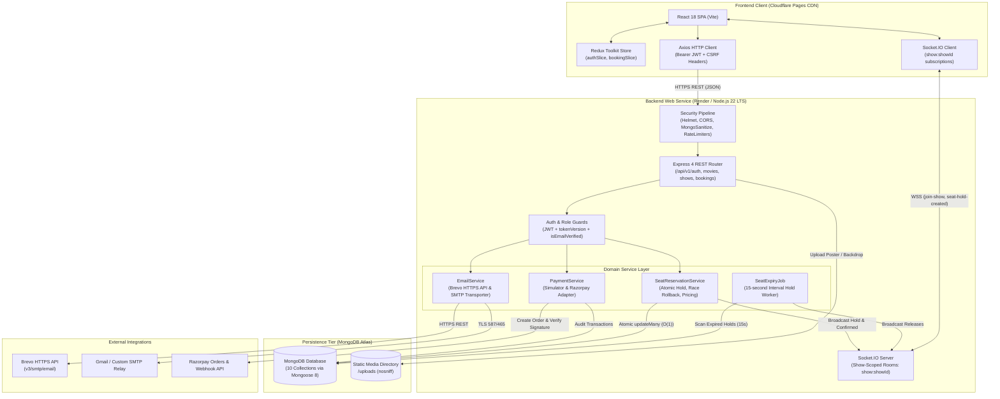
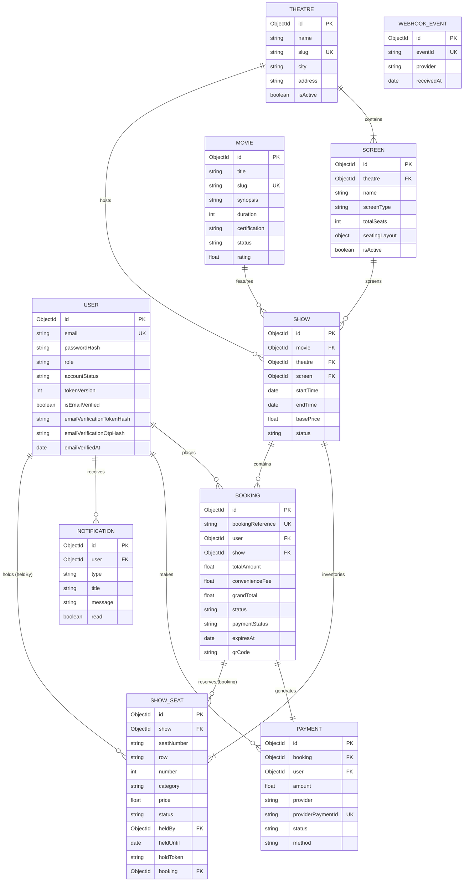
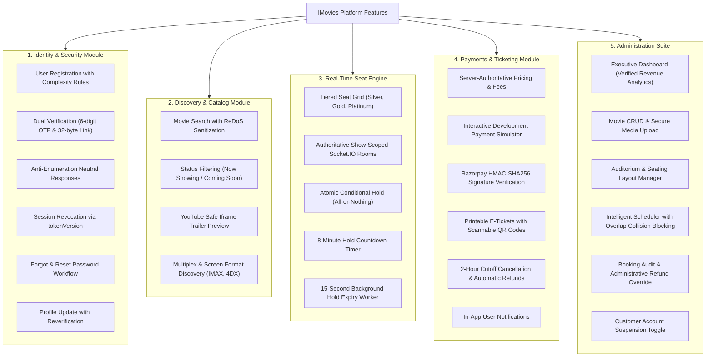
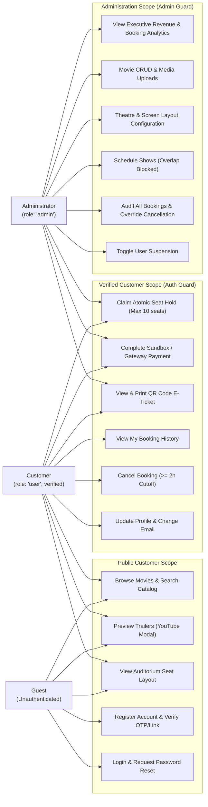
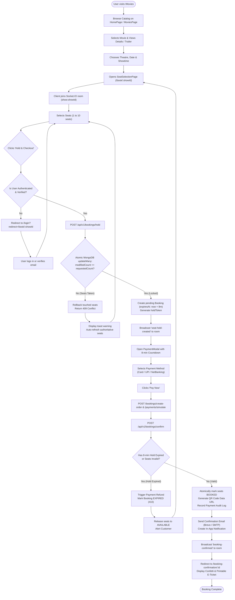
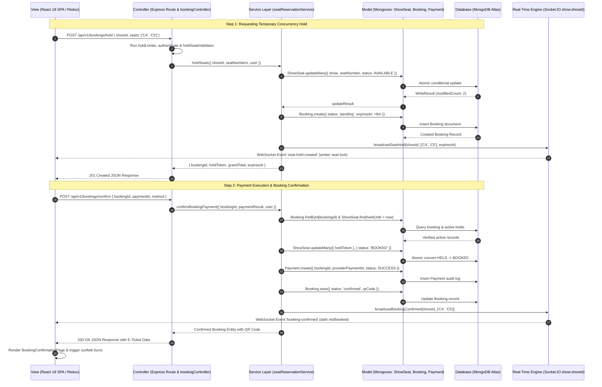

# iMovie Diagram Specification & Claude Generation Guide

**Document Version**: 1.0.0  
**Date**: October 26, 2026  
**Target Consumer**: Claude (or any senior diagramming AI agent)  
**Source Repository**: `nayan2427/IMovie-SkillWallet` (Verified against live codebase and 148 automated tests)

---

## Guide for Claude Diagram Generation

This document provides six mathematically verified, code-accurate specifications for generating professional architectural diagrams for the **iMovie** cinema management and online ticketing platform.

### Core Rules for Claude:
1. **Never assume Apple iMovie**: This project is a full-stack MERN cinema ticketing application named IMovies.
2. **Never invent Redis or RabbitMQ**: Concurrency holds and expirations are strictly handled directly in MongoDB with an in-memory 15-second background interval (`seatExpiryJob.js`).
3. **Never invent Microservices**: The backend is a modular monolithic Node.js / Express REST API and Socket.IO real-time server.
4. **Never invent OAuth / Social Login**: The application uses local email and bcrypt password credentials with dual-mode email verification (OTP + token link).
5. **Strictly adhere to the 10 real MongoDB models**: `User`, `Movie`, `Theatre`, `Screen`, `Show`, `ShowSeat`, `Booking`, `Payment`, `Notification`, and `WebhookEvent`.

---

# Diagram 1: Technical Architecture Diagram

### 1. Title and Objective
- **Title**: *IMovies — Full-Stack Technical Architecture & Communication Flow*
- **Objective**: Illustrate the complete system topology, separating frontend client concerns, backend middleware and services, database persistence, and third-party integrations.

### 2. Exact Nodes and Modules
- **Client Tier**:
  - `React SPA (React 18 + Vite)`
  - `Redux Store (authSlice, bookingSlice)`
  - `Axios HTTP Client (Bearer JWT + CSRF Headers)`
  - `Socket.IO Client (show room subscriptions)`
- **Server Tier**:
  - `Reverse Proxy Trust & Security Layer (Helmet, CORS, MongoSanitize, RateLimiters)`
  - `Express 4 REST Router (/api/v1/...)`
  - `Authentication & Guard Middleware (authenticate, requireAdmin, express-validator)`
  - `Socket.IO Real-Time Engine (Show-scoped rooms show:showId)`
  - `Seat Reservation Service (Atomic conditional locking & pricing)`
  - `Payment Service Abstraction (Simulator & Razorpay adapter)`
  - `Centralized Email Service (Brevo HTTPS API & Nodemailer SMTP)`
  - `Background Hold Expiry Job (15s interval worker)`
- **Data & Storage Tier**:
  - `MongoDB Atlas (10 Mongoose Collections)`
  - `Local Uploads Storage (/uploads with nosniff)`
- **External Services**:
  - `Brevo Transactional Email HTTPS API`
  - `Razorpay Payment Gateway API & Webhooks`
  - `SMTP Relay (Gmail / SES fallback)`

### 3. Relationships, Connections & Cardinalities
- `React SPA` dispatches actions to `Redux Store`.
- `React SPA` triggers HTTP requests through `Axios HTTP Client`.
- `Axios HTTP Client` sends REST requests to `Express 4 REST Router` via HTTPS.
- `React SPA` establishes persistent bi-directional WebSocket connection via `Socket.IO Client` to `Socket.IO Real-Time Engine`.
- `Express 4 REST Router` passes requests through `Reverse Proxy Trust & Security Layer` and `Authentication & Guard Middleware`.
- Middleware routes to `Seat Reservation Service`, `Payment Service Abstraction`, and `Centralized Email Service`.
- `Seat Reservation Service` executes atomic reads/writes to `MongoDB Atlas`.
- `Background Hold Expiry Job` scans `MongoDB Atlas` every 15s and invokes `Socket.IO Real-Time Engine` to broadcast releases.
- `Payment Service Abstraction` calls `Razorpay Payment Gateway API`.
- `Centralized Email Service` calls `Brevo Transactional Email HTTPS API` or `SMTP Relay`.

### 4. Direction of Arrows and Labels
- Client -> Server: `HTTPS REST (JSON)` and `WSS (Bi-directional)`
- Server -> Database: `Mongoose Queries (Atomic conditional updates)`
- Server -> External Services: `HTTPS REST / SMTP`
- Server -> Client: `Socket.IO Event Broadcast (show:showId)`

### 5. Prohibited / Unverified Details
- Do NOT include Redis, Kafka, RabbitMQ, Elasticsearch, Docker Swarm, or Kubernetes clusters.

### 6. Suggested Format
- **Type**: C4 Level 2 Container / Component Architecture Diagram.
- **Layout**: Top-to-Bottom or Left-to-Right layout with clear tier boundaries.

### 7. Syntactically Valid Mermaid Draft

---

# Diagram 2: Entity-Relationship (ER) Diagram

### 1. Title and Objective
- **Title**: *IMovies — Relational Data Schema & Entity Constraints*
- **Objective**: Model the exact 10 database entities, their primary keys, foreign keys, unique constraints, and relationship cardinalities as declared in Mongoose.

### 2. Exact Entities and Attributes

1. **USER (`users`)**:
   - `_id`: ObjectId [PK]
   - `email`: String [UK]
   - `passwordHash`: String
   - `role`: Enum ('user', 'admin')
   - `accountStatus`: Enum ('active', 'suspended', 'deleted')
   - `tokenVersion`: Number
   - `isEmailVerified`: Boolean
   - `emailVerificationTokenHash`: String
   - `emailVerificationOtpHash`: String
   - `passwordResetTokenHash`: String
2. **THEATRE (`theatres`)**:
   - `_id`: ObjectId [PK]
   - `name`: String
   - `slug`: String [UK]
   - `city`: String
   - `address`: String
   - `isActive`: Boolean
3. **SCREEN (`screens`)**:
   - `_id`: ObjectId [PK]
   - `theatre`: ObjectId [FK -> THEATRE]
   - `name`: String
   - `screenType`: Enum ('Standard', 'IMAX', '4DX', 'Dolby Atmos', 'Gold Class')
   - `totalSeats`: Number
   - `seatingLayout`: Object
   - `isActive`: Boolean
   - *Index*: `[theatre, name]` [UK]
4. **MOVIE (`movies`)**:
   - `_id`: ObjectId [PK]
   - `title`: String
   - `slug`: String [UK]
   - `duration`: Number
   - `certification`: Enum ('U', 'UA', 'A', 'PG', 'PG-13', 'R')
   - `status`: Enum ('now_showing', 'coming_soon', 'archived')
   - `genres`: Array
5. **SHOW (`shows`)**:
   - `_id`: ObjectId [PK]
   - `movie`: ObjectId [FK -> MOVIE]
   - `theatre`: ObjectId [FK -> THEATRE]
   - `screen`: ObjectId [FK -> SCREEN]
   - `startTime`: Date
   - `endTime`: Date
   - `basePrice`: Number
   - `status`: Enum ('scheduled', 'running', 'completed', 'cancelled')
6. **SHOW_SEAT (`showseats`)**:
   - `_id`: ObjectId [PK]
   - `show`: ObjectId [FK -> SHOW]
   - `seatNumber`: String
   - `category`: Enum ('SILVER', 'GOLD', 'PLATINUM')
   - `price`: Number
   - `status`: Enum ('AVAILABLE', 'HELD', 'BOOKED', 'BLOCKED')
   - `heldBy`: ObjectId [FK -> USER, Nullable]
   - `heldUntil`: Date [Nullable]
   - `holdToken`: String [Nullable]
   - `booking`: ObjectId [FK -> BOOKING, Nullable]
   - *Index*: `[show, seatNumber]` [UK]
7. **BOOKING (`bookings`)**:
   - `_id`: ObjectId [PK]
   - `bookingReference`: String [UK]
   - `user`: ObjectId [FK -> USER]
   - `show`: ObjectId [FK -> SHOW]
   - `totalAmount`: Number
   - `convenienceFee`: Number
   - `grandTotal`: Number
   - `status`: Enum ('pending', 'confirmed', 'cancelled', 'expired')
   - `paymentStatus`: Enum ('pending', 'success', 'failed', 'refunded')
   - `holdToken`: String
   - `expiresAt`: Date
   - `qrCode`: String
8. **PAYMENT (`payments`)**:
   - `_id`: ObjectId [PK]
   - `booking`: ObjectId [FK -> BOOKING]
   - `user`: ObjectId [FK -> USER]
   - `amount`: Number
   - `provider`: Enum ('simulated', 'razorpay', 'stripe')
   - `providerPaymentId`: String [UK, Sparse]
   - `status`: Enum ('pending', 'success', 'failed', 'refunded')
   - `method`: String
9. **NOTIFICATION (`notifications`)**:
   - `_id`: ObjectId [PK]
   - `user`: ObjectId [FK -> USER]
   - `type`: Enum ('booking_confirmed', 'booking_cancelled', 'hold_expired', 'reminder', 'system')
   - `title`: String
   - `read`: Boolean
10. **WEBHOOK_EVENT (`webhookevents`)**:
    - `_id`: ObjectId [PK]
    - `eventId`: String [UK]
    - `provider`: String
    - `receivedAt`: Date [TTL 7 days]

### 3. Relationship Cardinalities
- `THEATRE` 1 -- * `SCREEN`
- `THEATRE` 1 -- * `SHOW`
- `SCREEN` 1 -- * `SHOW`
- `MOVIE` 1 -- * `SHOW`
- `SHOW` 1 -- * `SHOW_SEAT`
- `USER` 1 -- * `BOOKING`
- `SHOW` 1 -- * `BOOKING`
- `BOOKING` 1 -- 1 `PAYMENT`
- `USER` 1 -- * `PAYMENT`
- `USER` 1 -- * `NOTIFICATION`
- `SHOW_SEAT` * -- 0..1 `USER` (`heldBy`)
- `SHOW_SEAT` * -- 0..1 `BOOKING` (`booking`)

### 4. Syntactically Valid Mermaid Draft

---

# Diagram 3: Feature Map & Functional Hierarchy

### 1. Title and Objective
- **Title**: *IMovies — Comprehensive Feature Decomposition & Functional Map*
- **Objective**: Display the hierarchical organization of implemented features divided into customer discovery, booking/concurrency engine, payment workflows, and administration tools.

### 2. Main Feature Groups
1. **Identity & Security**: Registration, Dual Email Verification (OTP + link), Login, Session Invalidation (`tokenVersion`), Password Reset, Profile Management.
2. **Movie & Venue Discovery**: Text Search (ReDoS-protected), Filters (Genres, Languages, Now Showing, Coming Soon), YouTube Trailer Modal, City/Auditorium Format Browsing.
3. **Seating & Real-Time Engine**: Interactive SVG/DOM Seat Map, Silver/Gold/Platinum Tiers, Live Socket.IO Updates (`show:${showId}`), Atomic Concurrency Hold, 8-Min Countdown.
4. **Checkout & Ticketing**: Server-authoritative Pricing, Sandbox Simulator, Razorpay Order Creation & HMAC Verification, Printable Ticket with QR Code, 2-Hour Cancellation Rule.
5. **Administration Suite**: Executive Dashboard Metrics (Real DB Revenue), Movie Management, Screen Layout Editor, Overlap Collision Prevention Scheduler, Booking Audit & Override Refund, User Suspension.

### 3. Syntactically Valid Mermaid Draft

---

# Diagram 4: Roles and Responsibilities (RBAC & Use Case)

### 1. Title and Objective
- **Title**: *IMovies — Role-Based Access Control (RBAC) & Use Case Diagram*
- **Objective**: Contrast the exact access privileges, boundaries, and capabilities of Unauthenticated Guests, Verified Customers, and System Administrators.

### 2. Actors & Boundaries
- **Actor 1: Guest (Unauthenticated Visitor)**
  - Access to public pages (`/`, `/movies`, `/theatres`, `/book/:showId` read-only).
  - Can submit registration and password recovery.
- **Actor 2: Verified Customer (`role: 'user'`)**
  - Requires `isEmailVerified: true` and `accountStatus: 'active'`.
  - Can claim 8-minute seat holds.
  - Can checkout, pay, view QR tickets, view `/my-bookings`, and cancel eligible tickets.
- **Actor 3: Administrator (`role: 'admin'`)**
  - Inherits all customer privileges.
  - Guarded by `AdminRoute.jsx` and `requireAdmin` middleware.
  - Full access to `/admin/*` operations.

### 3. Syntactically Valid Mermaid Draft

---

# Diagram 5: End-to-End User Flow & Decision Points

### 1. Title and Objective
- **Title**: *IMovies — Complete Ticket Reservation, Concurrency & Payment Lifecycle*
- **Objective**: Document the exact user journey with all branching logic (unauthenticated, seat conflict, hold expiry, payment decline, and successful ticket issuance).

### 2. Decision Branches
- `Is User Authenticated & Verified?` -> If No: redirect to `/login?redirect=...`.
- `Are Selected Seats Available?` -> Atomic update test:
  - If `modifiedCount !== seatNumbers.length`: 409 Conflict rollback -> Alert user and reload seat inventory.
  - If Success: Lock seats, start 8-minute timer.
- `Has 8-minute Hold Expired before Payment Confirmation?`
  - If Yes: Trigger automatic refund path, release seats, return 410 Expired.
  - If No: Convert seats to `BOOKED`, generate QR code, trigger confirmation email.

### 3. Syntactically Valid Mermaid Draft

---

# Diagram 6: Modern Decoupled MVC Interaction Flow

### 1. Title and Objective
- **Title**: *IMovies — Modern Decoupled MVC Pattern & Request Lifecycle*
- **Objective**: Explain how the React SPA presentation layer (View), Express controllers and routing (Controller), domain services, and Mongoose ODM models (Model) interact.

### 2. Layer Definitions & Real Source File Anchors
- **View (Presentation Layer)**:
  - React 18 Components & Pages ([client/src/pages/SeatSelectionPage.jsx](file:///c:/Users/nayan/OneDrive/Desktop/WEB%20COURESE/4_th/IMovie-SkillWallet/client/src/pages/SeatSelectionPage.jsx), [PaymentModal.jsx](file:///c:/Users/nayan/OneDrive/Desktop/WEB%20COURESE/4_th/IMovie-SkillWallet/client/src/components/booking/PaymentModal.jsx)).
  - Client state in Redux Toolkit ([bookingSlice.js](file:///c:/Users/nayan/OneDrive/Desktop/WEB%20COURESE/4_th/IMovie-SkillWallet/client/src/store/bookingSlice.js)).
- **Controller (Coordination Layer)**:
  - Express Route Dispatchers ([routes/bookingRoutes.js](file:///c:/Users/nayan/OneDrive/Desktop/WEB%20COURESE/4_th/IMovie-SkillWallet/server/src/routes/bookingRoutes.js)).
  - Controller request handlers ([bookingController.js](file:///c:/Users/nayan/OneDrive/Desktop/WEB%20COURESE/4_th/IMovie-SkillWallet/server/src/controllers/bookingController.js)).
  - Middleware guards (`authenticate`, `holdLimiter`, `holdSeatsValidator`).
- **Service Layer (Domain Business Logic)**:
  - Business transactions ([services/seatReservationService.js](file:///c:/Users/nayan/OneDrive/Desktop/WEB%20COURESE/4_th/IMovie-SkillWallet/server/src/services/seatReservationService.js)).
  - Payment adapter ([services/paymentService.js](file:///c:/Users/nayan/OneDrive/Desktop/WEB%20COURESE/4_th/IMovie-SkillWallet/server/src/services/paymentService.js)).
- **Model (Persistence & Schema Layer)**:
  - Mongoose models ([models/ShowSeat.js](file:///c:/Users/nayan/OneDrive/Desktop/WEB%20COURESE/4_th/IMovie-SkillWallet/server/src/models/ShowSeat.js), [models/Booking.js](file:///c:/Users/nayan/OneDrive/Desktop/WEB%20COURESE/4_th/IMovie-SkillWallet/server/src/models/Booking.js), [models/Payment.js](file:///c:/Users/nayan/OneDrive/Desktop/WEB%20COURESE/4_th/IMovie-SkillWallet/server/src/models/Payment.js)).
  - MongoDB database engine.

### 3. Syntactically Valid Mermaid Draft

---

## Summary Checklist for Claude

When Claude is prompted to generate final images or diagrams from this specification:
1. Use Diagram 1 for **Architecture**.
2. Use Diagram 2 for **Database / ER Modeling**.
3. Use Diagram 3 for **Features & Product Capabilities**.
4. Use Diagram 4 for **User Roles, RBAC & Use Cases**.
5. Use Diagram 5 for **User Journey & Concurrency Decision Flow**.
6. Use Diagram 6 for **Decoupled MVC Pattern & Request Lifecycle**.
